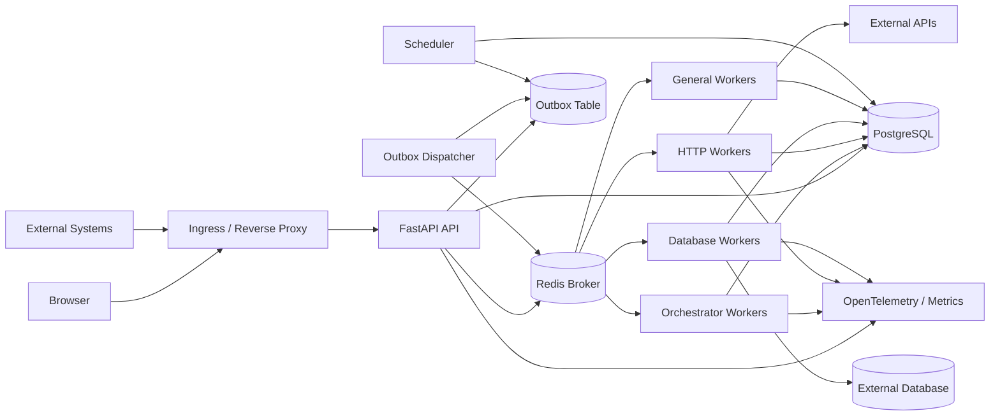
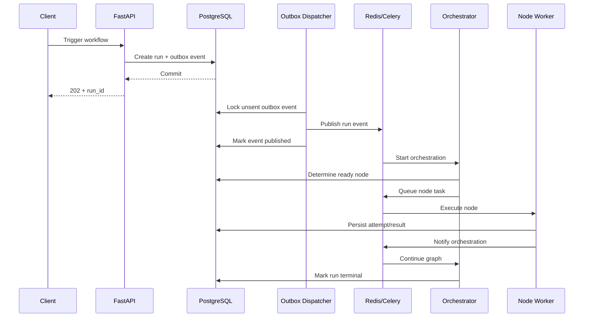

# OxyBridge — Production-Ready Development Roadmap & Product Requirements

> **Working product name:** OxyBridge  
> **Codename/brand origin:** FantoX  
> **Tagline:** _Connect systems. Orchestrate work. See every execution._  
> **Product type:** Self-hosted workflow automation and API integration platform  
> **Primary stack:** React + TypeScript, FastAPI, Celery, Redis, PostgreSQL, Docker, Kubernetes  
> **Document status:** Build specification / production roadmap  
> **Target:** Portfolio-quality MVP that can evolve into a commercially usable self-hosted product

---

## 1. Product Summary

OxyBridge is a visual workflow automation platform for connecting APIs, webhooks, databases, schedules, and background jobs.

It should solve a practical business problem:

> A system receives an event, validates and transforms its data, applies rules, calls one or more external services, stores results, retries recoverable failures, records every execution, and gives an operator a clear place to inspect or re-run failed work.

The product should feel like a focused, self-hosted alternative to the simpler parts of Zapier/n8n, but the goal is **not** to clone either product. The portfolio value comes from building the execution engine, reliability controls, API layer, observability, security, and deployment model properly.

### Main product promise

A user should be able to:

1. Create a workflow visually.
2. Add a trigger.
3. Add processing/action nodes.
4. Connect nodes.
5. Configure credentials securely.
6. Test the workflow using sample data.
7. Publish a version.
8. Trigger it by API, webhook, or schedule.
9. Watch execution progress in near real time.
10. Inspect inputs, outputs, timings, retries, and errors for every node.
11. Re-run a failed workflow safely.
12. Deploy the complete platform using Docker Compose or Kubernetes.

---

## 2. Product Naming

### Recommended name: **OxyBridge**

Why it fits:

- **Oxy** preserves the naming connection to FantoX.
- **Circuit** naturally communicates nodes, connections, flow, execution, and automation.
- It works for both the visual graph and backend execution engine.
- It sounds like a developer/business product rather than a generic hobby project.

### Alternative names

- OxyWeave — good for connecting systems, but similar names already exist.
- OxyMesh — technically relevant, but the name is already used in other industries.
- OxyBridge — good conceptually, but already used by industrial products.
- OxGraph — technical and concise, but less brandable.
- OxyRelay — strong for event/API automation.
- OxyRoute — strong if the product becomes integration-heavy.
- OxyPulse — good for event-driven processing, but less specific to workflows.

**Important:** `OxyBridge` is only a working product name. Before commercial launch, perform a proper trademark, company-name, GitHub, package-registry, and domain search. A normal web search is not legal clearance.

---

# PART I — PRODUCT REQUIREMENTS

## 3. Product Goals

### 3.1 MVP goals

The first usable release must demonstrate:

- Visual workflow construction.
- Webhook/API trigger.
- Manual trigger.
- Scheduled trigger.
- Generic HTTP/API action.
- JSON data transformation.
- Conditional branching.
- PostgreSQL-backed workflow definitions and execution history.
- Celery + Redis asynchronous processing.
- Retry policy with exponential backoff and jitter.
- Idempotency controls.
- Application-level dead-letter handling.
- Secure credential storage.
- Execution logs.
- Real-time or near-real-time execution status.
- Workflow versioning.
- Docker Compose deployment.
- Authentication.
- Basic role-based permissions.
- Health checks and metrics.
- Automated tests.
- CI pipeline.
- Production configuration guide.

### 3.2 Production V1 goals

After the MVP is stable, V1 adds:

- Multiple organizations/workspaces.
- Reusable workflow templates.
- API keys/service accounts.
- OAuth-based connectors.
- Workflow import/export.
- Custom retry policies by node.
- Pause/disable workflows.
- Execution cancellation.
- Alerting.
- Audit log.
- More connectors.
- Kubernetes manifests/Helm chart.
- Horizontal scaling.
- Backup and restore procedures.
- Stronger HA deployment guidance.
- OpenTelemetry tracing.
- Optional object storage for large execution payloads.

### 3.3 Explicit non-goals for MVP

Do **not** attempt these in the first version:

- Hundreds of third-party integrations.
- Arbitrary user-supplied Python/JavaScript execution.
- Full BPMN support.
- Long-running human approval workflows.
- Infinite loops in the workflow graph.
- Distributed transactions across external APIs.
- Exactly-once execution claims.
- AI agents as the core workflow engine.
- Multi-region active-active deployment.
- Full enterprise billing/licensing.
- Marketplace/plugin ecosystem.

These features will consume time without increasing the initial portfolio value proportionally.

---

## 4. Target Users

### 4.1 Backend developer

Needs to connect REST APIs, normalize payloads, schedule calls, process events, and debug failures without writing a dedicated service for every integration.

### 4.2 Small business technical operator

Needs reliable data movement between internal systems, CRMs, inventory platforms, supplier APIs, or databases.

### 4.3 DevOps/platform engineer

Needs self-hosted workflows, auditable execution history, retries, health visibility, and predictable deployment.

### 4.4 Freelancer/agency developer

Needs a platform that can be customized for clients and used to demonstrate:

- API integration work.
- Backend architecture.
- Background processing.
- Queue troubleshooting.
- Database design.
- Reliability engineering.
- Docker/Kubernetes deployment.

---

## 5. Core Use Cases

### Use case A — Order automation

```text
Webhook
  -> Validate payload
  -> Check condition
  -> Transform fields
  -> Call Inventory API
  -> Update PostgreSQL
  -> Call Shipping API
  -> Send completion webhook
```

### Use case B — Scheduled synchronization

```text
Cron schedule
  -> GET supplier products
  -> Normalize product JSON
  -> Compare existing records
  -> Upsert changed products
  -> Record statistics
```

### Use case C — Failure-aware API orchestration

```text
Incoming request
  -> Call API A
  -> Retry 3 times on 429/5xx
  -> If successful, call API B
  -> If permanently failed, move run to failed/dead-letter state
  -> Alert operator
```

### Use case D — Database-to-API batch

```text
Schedule
  -> PostgreSQL query
  -> Batch records
  -> Execute HTTP action for each batch
  -> Aggregate results
  -> Store execution summary
```

---

# PART II — FEATURE SPECIFICATION

## 6. Authentication and Account Management

### MVP

- Email + password login.
- Password hashing using Argon2id.
- Secure password reset flow.
- Access token/session with short lifetime.
- Rotating refresh/session token.
- Logout from current device.
- Optional "logout all sessions".
- User profile.
- Organization/workspace membership.
- Roles:
  - Owner
  - Admin
  - Editor
  - Viewer

### Security rules

- Do not store authentication tokens in `localStorage` if cookie-based sessions are used.
- Use `HttpOnly`, `Secure`, and appropriate `SameSite` cookie settings.
- CSRF protection when using cookie authentication for state-changing requests.
- Login rate limiting.
- Account enumeration protection.
- Audit security-sensitive actions.

### Later

- TOTP MFA.
- OIDC/SAML SSO.
- SCIM.
- External identity providers.

---

## 7. Workspace / Organization Model

Design multi-tenancy into the schema even if the first deployment has one organization.

Hierarchy:

```text
Organization
  ├── Members
  ├── Workspaces
  │    ├── Workflows
  │    ├── Connections
  │    ├── API Keys
  │    ├── Schedules
  │    └── Executions
  └── Audit Logs
```

Every tenant-owned table should carry either:

- `organization_id`, or
- `workspace_id` whose parent organization is enforced.

Never trust a client-provided organization ID without checking membership.

---

## 8. Workflow Builder

### Required functionality

- Infinite/pannable canvas.
- Zoom in/out.
- Fit view.
- Minimap optional for MVP.
- Drag node from node palette.
- Connect output handle to input handle.
- Delete node/edge.
- Duplicate node.
- Copy/paste node.
- Undo/redo.
- Multi-select.
- Auto-save draft.
- Unsaved-change indicator.
- Validate workflow.
- Test workflow.
- Publish workflow.
- View published version.
- Disable/enable workflow.

### Graph rules for MVP

- Directed graph.
- No arbitrary cycles.
- One or more trigger nodes allowed only if execution semantics are explicit; simplest MVP is **one trigger per workflow**.
- Every non-trigger node must be reachable from the trigger.
- Orphan nodes are warnings/errors.
- Node IDs are immutable UUIDs.
- Edges have stable UUIDs.
- Branching is allowed.
- Merging branches is allowed only after merge semantics are implemented.
- Loops come later and must be explicitly bounded.

### Workflow draft lifecycle

```text
DRAFT
  -> VALID
  -> PUBLISHED
  -> ACTIVE / PAUSED
  -> ARCHIVED
```

Publishing creates an immutable `workflow_version`.

A running execution always points to an immutable version so later edits cannot alter an already-running job.

---

## 9. Node Types

### 9.1 Trigger nodes

#### Manual Trigger

Used from the editor to test a workflow.

#### Webhook Trigger

Provides a generated URL.

Options:

- HTTP methods: POST initially; GET later.
- Optional HMAC verification.
- Static token/header authentication.
- JSON payload validation.
- Max body size.
- Allowed content types.
- Response mode:
  - Immediate `202 Accepted`.
  - Wait-for-workflow-result with a strict timeout — later.

#### API Trigger

Authenticated programmatic execution:

```http
POST /api/v1/workflows/{workflow_id}/run
```

#### Schedule Trigger

Cron or friendly schedule:

- Every N minutes.
- Hourly.
- Daily.
- Weekly.
- Advanced cron.
- Timezone required.
- Show "next 5 run times" before saving.

### 9.2 Processing nodes

#### Validate JSON

Validate data against a JSON Schema.

Outputs:

- valid
- invalid

#### Transform / Map Fields

Map fields using a constrained expression language.

Examples:

```text
customer.email -> body.email
order.total -> body.amount
"source-system" -> headers.X-Source
```

Do not execute raw `eval()`.

#### Condition

Operators:

- equals
- not equals
- contains
- exists
- greater/less than
- regex
- AND/OR groups

Outputs:

- true
- false

#### Delay

Delay execution for a bounded time.

Long delays should not hold a worker process. Represent the node as scheduled/resumable work.

### 9.3 Action nodes

#### HTTP Request

This is the most important MVP connector.

Options:

- GET/POST/PUT/PATCH/DELETE
- URL template
- Headers
- Query parameters
- JSON body
- Form body later
- Timeout
- Retry policy
- Expected status codes
- Authentication:
  - none
  - bearer
  - API key header
  - basic auth
  - connection/credential reference
- Follow redirects option
- Response extraction
- Maximum response size

#### PostgreSQL Query

For MVP, strongly favor parameterized queries.

Modes:

- Read query.
- Write query — explicit permission.
- Transaction mode later.

Never concatenate user variables into SQL strings.

#### Set Variable

Create/override workflow data.

#### Webhook Response / Callback

Send final result to a configured callback URL.

### Later node types

- MySQL.
- SMTP/email.
- Slack.
- Microsoft Teams.
- S3/MinIO.
- File parser.
- CSV parser.
- Loop/batch.
- Merge.
- Sub-workflow.
- OAuth integrations.
- AI/LLM action.
- Human approval.

---

## 10. Workflow Variables and Data Model

Use a predictable execution context.

Example:

```json
{
  "run": {
    "id": "run_uuid",
    "started_at": "..."
  },
  "trigger": {
    "headers": {},
    "query": {},
    "body": {}
  },
  "nodes": {
    "node_uuid": {
      "status": "success",
      "output": {}
    }
  },
  "env": {
    "workspace": "production"
  }
}
```

### Expression syntax

Prefer a safe restricted syntax such as:

```text
{{ trigger.body.customer.email }}
{{ nodes.fetch_customer.output.id }}
{{ env.workspace }}
```

Do not give expressions access to:

- filesystem,
- subprocess,
- Python internals,
- network,
- process environment.

Implement a small parser/resolver rather than unrestricted Jinja/Python execution.

---

## 11. Workflow Validation

Before publishing, run validation for:

- Trigger exists.
- Every required configuration field is present.
- All connections reference existing nodes.
- No illegal cycles.
- All non-trigger nodes are reachable.
- Required credentials exist.
- Referenced variables can be resolved where statically possible.
- Node input/output compatibility.
- HTTP URLs are syntactically valid.
- Schedules are valid.
- Workflow size limits.
- Duplicate node IDs.
- Unsupported workflow schema version.

Return validation as structured errors:

```json
{
  "valid": false,
  "errors": [
    {
      "code": "MISSING_CREDENTIAL",
      "node_id": "...",
      "field": "connection_id",
      "message": "Select an API credential."
    }
  ],
  "warnings": []
}
```

---

# PART III — EXECUTION ENGINE

## 12. Execution Semantics

The execution engine is the core of the project.

Do **not** treat the browser canvas itself as the execution model.

The frontend saves a versioned graph. The backend validates and compiles that graph into an executable plan.

### Execution stages

```text
1. Trigger received
2. Authenticate/validate trigger
3. Resolve active workflow version
4. Create workflow_run row
5. Persist trigger input
6. Publish durable execution event
7. Orchestrator finds ready nodes
8. Node task dispatched
9. Worker executes node
10. Node result persisted
11. Orchestrator evaluates downstream dependencies
12. More nodes dispatched
13. Final workflow state calculated
14. Metrics/logs emitted
15. Optional callback/notification emitted
```

### Recommended architecture

Use a small **orchestrator layer** rather than building the complete product as one enormous Celery chain.

The orchestrator should:

- Own workflow state.
- Determine which nodes are ready.
- Dispatch node executions.
- Process completed node events.
- Mark downstream nodes ready.
- Calculate terminal status.
- Manage cancellation.
- Handle retries and dead-letter state.

Celery is then a distributed task execution mechanism, not the source of truth.

**PostgreSQL is the durable source of truth for workflow state.**

---

## 13. Delivery Guarantees

Do not claim "exactly once".

Across PostgreSQL, Redis, workers, and external APIs, true exactly-once side effects cannot generally be guaranteed.

Target:

> **At-least-once task delivery + idempotent processing + durable execution state.**

### Idempotency design

Each node attempt should have a key similar to:

```text
{workflow_run_id}:{node_id}:{logical_execution_number}
```

For operations that support idempotency keys, pass one downstream.

For internal writes:

- Use unique DB constraints.
- Use UPSERT where appropriate.
- Record completed node execution before acknowledging the task when safe.
- Detect duplicate deliveries.

A duplicate worker delivery must not create duplicate business effects where preventable.

---

## 14. Reliable Enqueue — Transactional Outbox

A classic failure mode is:

```text
Database run row committed
-> process crashes
-> Celery message was never published
```

or:

```text
Message published
-> database transaction rolls back
```

Production V1 should use a transactional outbox.

### Transaction

Within the same PostgreSQL transaction:

```text
INSERT workflow_run
INSERT outbox_event(type='workflow.run.created', payload=...)
COMMIT
```

A dedicated dispatcher service:

1. Polls unsent outbox rows.
2. Uses `FOR UPDATE SKIP LOCKED`.
3. Publishes the event/task.
4. Marks the outbox record sent.
5. Retries publish failures.

This significantly reduces lost-work edge cases.

---

## 15. Celery Queue Design

Suggested queues:

```text
orchestrator
http
database
default
callbacks
maintenance
```

Routing examples:

- workflow orchestration -> `orchestrator`
- generic REST calls -> `http`
- database action -> `database`
- callbacks -> `callbacks`

Benefits:

- Different concurrency by workload.
- Slow external APIs do not starve orchestration.
- Database jobs can have stricter concurrency.
- Easier troubleshooting.

### Worker configuration principles

For idempotent tasks requiring redelivery after worker loss:

- `task_acks_late = True`
- carefully evaluate `task_reject_on_worker_lost`
- `worker_prefetch_multiplier = 1` for long/variable tasks

Use:

- soft time limit for cleanup.
- hard time limit as final protection.
- per-node HTTP timeouts.
- retry limits.
- exponential backoff.
- jitter.

Never allow unbounded retry loops.

---

## 16. Retry Model

Each action node supports:

```text
Max attempts:        1-10
Initial delay:       e.g. 2 s
Backoff multiplier:  e.g. 2
Maximum delay:       e.g. 120 s
Jitter:              enabled
Retry on:
  - connection errors
  - timeouts
  - HTTP 429
  - HTTP 5xx
Do not retry:
  - most HTTP 4xx
  - validation failure
  - authentication failure unless explicitly configured
```

Example:

```text
Attempt 1 -> immediate
Attempt 2 -> ~2 s
Attempt 3 -> ~4 s
Attempt 4 -> ~8 s
```

with random jitter.

Persist every attempt.

---

## 17. Dead-Letter Handling

Celery + Redis should not be presented as if it provides RabbitMQ-style DLQ behavior automatically.

Implement application-level dead-letter semantics.

When attempts are exhausted:

```text
node_run.status = FAILED
workflow_run.status = FAILED
dead_letter_item created
```

Dead-letter UI shows:

- workflow
- node
- input summary
- final error
- number of attempts
- first failure
- last failure
- correlation/run ID
- "retry node" or "re-run workflow" action

Re-run must create a new execution or an explicitly linked recovery execution. Do not silently rewrite history.

---

## 18. Cancellation

Execution states:

```text
QUEUED
RUNNING
SUCCEEDED
FAILED
CANCEL_REQUESTED
CANCELLED
TIMED_OUT
```

Cancellation behavior:

- Stop dispatching new nodes.
- Existing external network calls may not be safely interruptible.
- Mark in-flight work appropriately.
- Workers check cancellation before expensive/side-effecting steps.
- Never report a node as cancelled if the external side effect already completed.

---

# PART IV — DATABASE DESIGN

## 19. PostgreSQL Schema

Use UUID primary keys.

### organizations

```text
id
name
slug
created_at
updated_at
```

### users

```text
id
email
password_hash
display_name
is_active
created_at
updated_at
```

### organization_members

```text
organization_id
user_id
role
created_at
```

Unique:

```text
(organization_id, user_id)
```

### workspaces

```text
id
organization_id
name
slug
environment
created_at
updated_at
```

### workflows

```text
id
workspace_id
name
description
status
draft_definition JSONB
active_version_id NULL
created_by
created_at
updated_at
```

### workflow_versions

```text
id
workflow_id
version_number
schema_version
definition JSONB
definition_hash
published_by
published_at
```

Unique:

```text
(workflow_id, version_number)
```

### workflow_runs

```text
id
workflow_id
workflow_version_id
workspace_id
trigger_type
status
idempotency_key NULL
trigger_payload JSONB
started_at
finished_at
duration_ms
error_code NULL
error_message_redacted NULL
created_at
```

Indexes:

```text
(workflow_id, created_at DESC)
(workspace_id, status, created_at DESC)
(status, created_at)
```

### node_runs

```text
id
workflow_run_id
node_id
node_type
status
attempt
input_data JSONB
output_data JSONB
started_at
finished_at
duration_ms
error_type
error_message_redacted
http_status NULL
worker_id NULL
```

Indexes:

```text
(workflow_run_id, node_id)
(status, started_at)
```

### connections

Stores integration configuration without exposing secrets directly.

```text
id
workspace_id
name
type
config JSONB
encrypted_secret BYTEA/TEXT
key_version
created_by
created_at
updated_at
```

### schedules

```text
id
workflow_id
cron_expression
timezone
enabled
next_run_at
last_run_at
created_at
updated_at
```

### webhook_endpoints

```text
id
workflow_id
public_token_hash
secret_id NULL
enabled
created_at
```

### api_keys

```text
id
workspace_id
name
key_prefix
key_hash
scopes
last_used_at
expires_at
revoked_at
created_at
```

Store only a hash of the API key after initially displaying it.

### idempotency_records

```text
id
workspace_id
scope
idempotency_key
request_hash
result_reference
expires_at
created_at
```

Unique:

```text
(workspace_id, scope, idempotency_key)
```

### outbox_events

```text
id
aggregate_type
aggregate_id
event_type
payload JSONB
created_at
published_at NULL
attempt_count
last_error NULL
```

### audit_logs

```text
id
organization_id
workspace_id NULL
actor_user_id NULL
action
resource_type
resource_id
metadata JSONB
ip_hash_or_redacted
created_at
```

### dead_letter_items

```text
id
workspace_id
workflow_run_id
node_run_id
reason
payload_reference
resolved_at NULL
resolved_by NULL
created_at
```

---

## 20. Database Engineering Rules

- Use migrations with Alembic.
- Never edit production schema manually.
- Use foreign keys.
- Use unique constraints for invariants.
- Use `TIMESTAMPTZ`.
- Store timestamps in UTC.
- Use JSONB where schema flexibility is necessary, not as a replacement for every relational table.
- Limit size of stored request/response bodies.
- Redact secrets before persistence.
- Add retention jobs for old logs/payloads.
- Analyze indexes using real execution data.
- Use connection pooling.
- Add PgBouncer later if connection count requires it.
- Backups must be tested by restoring them.

---

# PART V — BACKEND ARCHITECTURE

## 21. Recommended Backend Stack

### Application

- Python 3.13 as a conservative production baseline.
- FastAPI.
- Pydantic v2.
- SQLAlchemy 2.x.
- Alembic.
- Psycopg 3.
- Celery 5.6.x.
- Redis.
- PostgreSQL 18.x on new deployments unless an existing production standard requires another supported major.
- `httpx` for outbound HTTP.
- `structlog` or standard logging with JSON formatting.
- OpenTelemetry.
- Prometheus metrics endpoint.

Pin exact dependency versions in the lockfile and upgrade deliberately.

### Why FastAPI

- Typed request/response models.
- OpenAPI generation.
- Async-friendly HTTP layer.
- Strong fit for APIs and webhooks.
- Clear dependency injection model.

### Why not use Flask here?

Flask can absolutely implement the product, but for a fresh build the typed FastAPI/Pydantic/OpenAPI workflow reduces repetitive API validation code and makes the public API easier to document.

---

## 22. Backend Service Boundaries

Start as a **modular monolith + worker processes**, not microservices.

Processes:

```text
api
worker-orchestrator
worker-http
worker-database
worker-default
scheduler
outbox-dispatcher
```

They can live in one repository and initially share Python packages.

This gives operational separation without premature distributed-service complexity.

---

## 23. Suggested Repository Structure

```text
OxyBridge/
├── apps/
│   ├── api/
│   │   ├── main.py
│   │   ├── routes/
│   │   ├── dependencies/
│   │   └── middleware/
│   ├── worker/
│   │   ├── celery_app.py
│   │   ├── tasks/
│   │   └── queues.py
│   ├── scheduler/
│   └── outbox_dispatcher/
│
├── packages/
│   ├── domain/
│   │   ├── workflow/
│   │   ├── execution/
│   │   ├── auth/
│   │   └── integrations/
│   ├── db/
│   │   ├── models/
│   │   ├── repositories/
│   │   └── migrations/
│   ├── engine/
│   │   ├── compiler/
│   │   ├── executor/
│   │   ├── expressions/
│   │   └── validation/
│   ├── observability/
│   └── security/
│
├── web/
│   ├── src/
│   └── tests/
│
├── deploy/
│   ├── compose/
│   ├── kubernetes/
│   └── helm/
│
├── tests/
│   ├── integration/
│   ├── contract/
│   └── e2e/
│
├── docs/
├── pyproject.toml
├── docker-compose.yml
└── README.md
```

Do not create separate repositories for every process initially.

---

## 24. Backend API Modules

Suggested routes:

```text
/api/v1/auth/*
/api/v1/users/*
/api/v1/organizations/*
/api/v1/workspaces/*
/api/v1/workflows/*
/api/v1/workflow-runs/*
/api/v1/connections/*
/api/v1/schedules/*
/api/v1/api-keys/*
/api/v1/audit/*
/api/v1/admin/*
/hooks/v1/*
/health/live
/health/ready
/metrics
```

---

## 25. Key REST Endpoints

### Workflows

```text
GET    /api/v1/workflows
POST   /api/v1/workflows
GET    /api/v1/workflows/{id}
PATCH  /api/v1/workflows/{id}
DELETE /api/v1/workflows/{id}

POST   /api/v1/workflows/{id}/validate
POST   /api/v1/workflows/{id}/publish
POST   /api/v1/workflows/{id}/run
POST   /api/v1/workflows/{id}/pause
POST   /api/v1/workflows/{id}/resume

GET    /api/v1/workflows/{id}/versions
GET    /api/v1/workflows/{id}/versions/{version}
```

### Runs

```text
GET  /api/v1/workflow-runs
GET  /api/v1/workflow-runs/{run_id}
POST /api/v1/workflow-runs/{run_id}/cancel
POST /api/v1/workflow-runs/{run_id}/rerun
GET  /api/v1/workflow-runs/{run_id}/events
```

### Connections

```text
GET    /api/v1/connections
POST   /api/v1/connections
PATCH  /api/v1/connections/{id}
DELETE /api/v1/connections/{id}
POST   /api/v1/connections/{id}/test
```

### Schedules

```text
GET    /api/v1/schedules
POST   /api/v1/schedules
PATCH  /api/v1/schedules/{id}
DELETE /api/v1/schedules/{id}
```

---

## 26. Real-Time UI Updates

Use **Server-Sent Events (SSE)** first.

Why:

- Browser receives one-way run updates.
- Simpler than WebSockets.
- Works well for status/event streams.
- Automatic browser reconnection support.
- Most editing operations still use REST.

Example stream:

```text
GET /api/v1/workflow-runs/{run_id}/events/stream
```

Events:

```text
run.started
node.queued
node.started
node.retrying
node.succeeded
node.failed
run.succeeded
run.failed
run.cancelled
```

WebSockets can be introduced later if collaborative editing or bidirectional real-time features are added.

---

# PART VI — FRONTEND / UI / UX

## 27. Recommended Frontend Stack

- React.
- TypeScript with strict mode.
- Vite.
- `@xyflow/react` for the workflow canvas.
- TanStack Query for server state.
- Zustand for editor-local state.
- Zod for frontend schema validation.
- React Hook Form.
- Tailwind CSS.
- shadcn/ui or a similarly consistent primitive/component system.
- Recharts for metrics.
- Monaco editor only where JSON/schema editing genuinely needs it.
- Playwright for end-to-end tests.
- Vitest + Testing Library for component/unit tests.

---

## 28. Visual Direction

Use the attached workflow dashboard as a **layout reference**, not something to copy.

Recommended design characteristics:

- Clean neutral application shell.
- Strong workspace hierarchy.
- Large central graph canvas.
- Compact left navigation.
- Contextual right inspector.
- Bottom execution/debug drawer.
- Clear success/warning/error state colors.
- Small but readable metrics.
- Light and dark themes.
- Developer-tool precision rather than marketing-site decoration.

### Brand direction

Suggested OxyBridge visual identity:

```text
Primary accent: electric violet / indigo
Secondary accent: cyan
Success: green
Warning: amber
Error: red
Neutral: slate/gray
```

The actual implementation must maintain accessible contrast ratios.

---

## 29. Main Application Layout

Desktop:

```text
┌───────────────────────────────────────────────────────────────────────┐
│ Top Bar: Workspace | Search | Environment | Run | Publish | User    │
├─────────────┬───────────────────────────────────────┬─────────────────┤
│             │                                       │                 │
│ Left Nav    │          Workflow Canvas              │ Right Inspector │
│             │                                       │                 │
│ Workflows   │      [Trigger] -> [HTTP] -> [IF]     │ Node Settings   │
│ Runs        │                         \-> [DB]       │ Inputs          │
│ Connections │                                       │ Retry           │
│ Schedules   │                                       │ Output mapping  │
│ Templates   │                                       │ Test            │
│ Audit       │                                       │                 │
├─────────────┴───────────────────────────────────────┴─────────────────┤
│ Collapsible Run Console / Logs / Timeline                            │
└───────────────────────────────────────────────────────────────────────┘
```

---

## 30. Required Screens

### 30.1 Login

- Product logo/name.
- Email.
- Password.
- Forgot password.
- Self-hosted instance URL/version in footer.

### 30.2 Dashboard

Cards:

- Active workflows.
- Executions today.
- Success rate.
- Failed executions.
- Queue depth.
- Average duration.

Charts:

- executions/hour
- success vs failure
- execution latency trend

Panels:

- recent failures
- recently edited workflows
- system health

### 30.3 Workflows List

Columns/cards:

- Name.
- Status.
- Trigger.
- Last execution.
- Success rate.
- Published version.
- Owner.
- Updated time.

Actions:

- Open.
- Run.
- Duplicate.
- Export.
- Pause.
- Archive.

Filters:

- active
- paused
- failed recently
- trigger type
- owner

### 30.4 Workflow Builder

Header:

```text
Workflow name
Draft / Published badge
Auto-save state
Validate
Test Run
Publish
More menu
```

Left node palette:

```text
Triggers
  Manual
  Webhook
  Schedule

Logic
  Condition
  Transform
  Validate
  Set Variable

Actions
  HTTP Request
  PostgreSQL
  Callback
```

Center:

- React Flow canvas.
- grid background.
- zoom.
- fit.
- snap optional.
- selected edge/node states.

Right inspector:

- node title/type
- configuration
- authentication/connection
- input mapping
- retry
- timeout
- advanced
- test node
- delete

Bottom drawer:

Tabs:

```text
Execution
Logs
Input
Output
Errors
```

### 30.5 Execution History

Filters:

- workflow
- status
- trigger
- date
- duration
- search by run ID

Columns:

```text
Run ID
Workflow
Version
Trigger
Status
Started
Duration
Retries
```

### 30.6 Execution Detail

This is one of the most important portfolio screens.

Show:

- Status.
- Run ID.
- Workflow version.
- Started/ended time.
- Total duration.
- Trigger summary.
- Node-by-node timeline.
- Attempt count.
- Queue wait time.
- Processing time.
- Input.
- Redacted output.
- Error.
- Worker/queue metadata.
- Rerun button.
- Cancel button where applicable.

Visual graph should color nodes by execution result:

```text
gray    not reached
blue    running
green   succeeded
amber   retrying
red     failed
```

### 30.7 Connections

Cards/table:

```text
Connection name
Type
Scope
Last tested
Last used
Status
```

Actions:

- Add.
- Edit metadata.
- Replace secret.
- Test.
- Delete.

Never display stored secret values after creation.

### 30.8 Schedules

Show:

- workflow
- cron/friendly expression
- timezone
- next run
- last run
- enabled

### 30.9 Dead Letter / Failed Work

Show unrecovered failures and allow:

- inspect
- mark resolved
- rerun entire workflow
- retry eligible node
- copy correlation ID

### 30.10 Settings

Sections:

- General.
- Members.
- Roles.
- API keys.
- Retention.
- Security.
- Audit.
- System status.
- Version/build info.

---

## 31. UX Rules

### Builder

- Never lose a draft silently.
- Auto-save after short debounce.
- Display save state.
- Warn before navigating away if unsaved.
- Publish is separate from save.
- Invalid workflow cannot publish.
- Node errors visible on canvas.
- Clicking an error focuses the offending field/node.

### Destructive operations

Require confirmation for:

- delete workflow
- delete connection
- revoke API key
- archive workflow

Do not require modal confirmation for low-risk actions such as removing an unconfigured draft node; undo is better.

### Error messages

Bad:

```text
Something went wrong.
```

Good:

```text
HTTP Request failed after 3 attempts.
Last response: 503 Service Unavailable.
Run ID: 2aa...
```

Do not expose credentials or full sensitive payloads.

---

## 32. Accessibility

Minimum target: WCAG 2.2 AA where practical.

Requirements:

- Keyboard-navigable navigation.
- Visible focus states.
- Canvas actions accessible through keyboard/menu alternatives.
- Do not encode status using color alone.
- Tooltips for icon-only buttons.
- Form fields have labels.
- Error messages are associated with fields.
- Sufficient contrast.
- Reduced-motion support.

---

# PART VII — SECURITY

## 33. Threat Model

OxyBridge is more security-sensitive than a normal CRUD app because it:

- Stores third-party credentials.
- Accepts public webhook traffic.
- Makes outbound network calls.
- Can query databases.
- Moves business data between systems.

Security must be part of architecture, not an end-of-project task.

---

## 34. Secret Storage

Never store secrets in plaintext.

MVP:

- Encrypt integration credentials at application level using a master key supplied through deployment secrets.
- Use authenticated encryption such as AES-GCM.
- Store `key_version`.
- Support rotation later.

Production:

- Prefer Vault / cloud KMS / external secret manager where available.

Logs must redact:

- Authorization headers.
- cookies.
- API keys.
- passwords.
- tokens.
- configured sensitive fields.

---

## 35. SSRF Protection

The HTTP Request node is an SSRF surface.

Attack example:

```text
User creates request to:
http://169.254.169.254/...
http://127.0.0.1:...
http://redis:6379/...
http://kubernetes.default.svc/...
```

Required defenses:

- Validate URL scheme.
- Allow only HTTP/HTTPS.
- Resolve hostname and check IP ranges.
- Reject loopback.
- Reject link-local.
- Reject private/internal ranges by default.
- Re-check after redirects.
- Defend against DNS rebinding.
- Limit redirect count.
- Block credentials in URL.
- Configurable outbound allowlists.
- Kubernetes NetworkPolicy/egress restrictions.
- Explicit administrator option for approved private destinations.

This should be treated as a release-blocking security requirement.

---

## 36. Webhook Security

Options:

- random unguessable endpoint token.
- HMAC signature.
- timestamped signatures to reduce replay.
- IP allowlist optional.
- per-endpoint rate limits.
- body-size limit.
- content-type enforcement.

Return a correlation/run ID.

---

## 37. Database Connector Security

- Parameterized queries only.
- Separate DB credentials for the connector.
- Recommend read-only DB users for read connectors.
- Configurable statement timeout.
- Limit returned rows.
- Limit payload size.
- Do not expose internal stack traces.
- Optional hostname/network allowlist.
- Never allow arbitrary DSNs containing secret values to be shown after save.

---

## 38. API Security

- Strict request schemas.
- Maximum body size.
- Rate limiting.
- CORS allowlist.
- No wildcard production CORS with credentials.
- Security headers.
- Request IDs.
- Input normalization.
- API scope checks.
- RBAC checks server-side.
- Dependency/security scanning.
- Container runs as non-root.
- Read-only filesystem where practical.
- Drop Linux capabilities where practical.

---

# PART VIII — OBSERVABILITY

## 39. Structured Logging

Every log event should contain useful correlation fields:

```json
{
  "timestamp": "...",
  "level": "INFO",
  "service": "worker-http",
  "event": "node_execution_finished",
  "organization_id": "...",
  "workflow_id": "...",
  "workflow_run_id": "...",
  "node_id": "...",
  "node_run_id": "...",
  "attempt": 2,
  "duration_ms": 431,
  "status": "success"
}
```

Never rely on human-formatted strings alone.

---

## 40. Metrics

### API

- requests total.
- response status.
- request duration.
- active requests.
- webhook requests.
- rate-limit hits.

### Workflow

- runs started.
- runs succeeded.
- runs failed.
- run duration.
- node duration.
- retry count.
- timeout count.
- dead-letter count.

### Queue

- queue depth.
- oldest waiting task age.
- task wait time.
- task runtime.
- worker availability.

### Database

- pool usage.
- query latency.
- transaction failures.
- connection errors.

---

## 41. Tracing

Use OpenTelemetry.

Trace structure:

```text
Webhook HTTP request
  -> create workflow run
  -> enqueue orchestration
  -> execute node A
      -> outbound HTTP request
  -> execute node B
      -> PostgreSQL query
```

Propagate trace/correlation IDs through task metadata.

This is one of the strongest portfolio demonstrations because distributed queue delays become visible.

---

## 42. Health Endpoints

### Liveness

```text
GET /health/live
```

Only proves the process is alive.

### Readiness

```text
GET /health/ready
```

Checks dependencies required to accept traffic.

Do not make liveness depend on a temporarily unavailable database; otherwise Kubernetes may restart healthy application processes unnecessarily.

---

# PART IX — DEPLOYMENT

## 43. Local Development

Docker Compose services:

```text
web
api
worker-orchestrator
worker-http
worker-database
scheduler
outbox-dispatcher
postgres
redis
```

Optional:

```text
prometheus
grafana
otel-collector
minio
```

Developer commands should make these easy:

```text
make up
make down
make test
make lint
make migrate
make seed
make logs
```

---

## 44. Production Docker Compose

Suitable for:

- demo.
- portfolio.
- small single-server customer installation.

Production Compose must include:

- pinned image versions.
- restart policies.
- resource limits where supported.
- health checks.
- persistent volumes.
- secrets from environment/file/secret mechanism.
- reverse proxy/TLS.
- scheduled database backups.
- log rotation.
- separate Redis/Postgres persistence.

Do not claim single-host Compose is highly available.

---

## 45. Kubernetes Architecture

Recommended production topology:

```text
Ingress / Gateway
       |
       v
  API Deployment  (2+ replicas)
       |
       +-----------------+
       |                 |
       v                 v
 PostgreSQL          Redis
       ^                 ^
       |                 |
       +-------+---------+
               |
        Celery Workers
       /      |       \
orchestrator http    database

Scheduler: one active logical scheduler
Outbox dispatcher: replicated only if row locking safely supports it
```

### Kubernetes resources

- Namespace.
- ConfigMaps.
- Secrets.
- Deployments.
- Services.
- Ingress/Gateway.
- HPA.
- PodDisruptionBudget.
- NetworkPolicy.
- ServiceAccount.
- resource requests/limits.
- startup/readiness/liveness probes.
- topology spread/anti-affinity for HA deployments.

Use a managed or properly operated PostgreSQL/Redis service when production reliability matters more than demonstrating stateful Kubernetes.

---

## 46. Autoscaling Strategy

### API

Scale using:

- CPU as baseline.
- request rate or latency later.

### Celery workers

CPU is often a poor queue-worker signal.

Prefer:

- queue depth.
- age of oldest queued task.
- custom metrics.

Separate worker queues allow independent scaling.

Example:

```text
worker-http:
  min 2
  max 20

worker-database:
  min 1
  max 5
```

Do not autoscale the database worker so aggressively that it overwhelms PostgreSQL or a downstream service.

---

## 47. Graceful Shutdown

API:

- Stop accepting new connections.
- Finish in-flight requests within grace period.

Workers:

- Stop consuming new work.
- Finish/requeue tasks based on acknowledgment semantics.
- Respect termination grace period.

Kubernetes rolling deployments must not casually discard active workflow execution.

---

## 48. Database Backups

Minimum policy:

- automated daily logical or physical backup.
- retention.
- backup stored separately from DB volume.
- restore test.
- documented Recovery Point Objective and Recovery Time Objective.

A backup that has never been restored is not proven.

---

# PART X — SCHEDULING

## 49. Scheduler Design

For MVP, Celery Beat is acceptable, but there must be only one effective scheduler instance unless a leader-election/persistent-scheduler design explicitly supports HA.

Recommended production approach:

- Store user schedules in PostgreSQL.
- Maintain `next_run_at`.
- Scheduler polls due rows.
- Lock due schedules using `FOR UPDATE SKIP LOCKED`.
- Creates runs transactionally.
- Updates `next_run_at`.

This makes schedules inspectable and reduces reliance on opaque local Beat state.

Every schedule stores its timezone explicitly.

---

# PART XI — FRONTEND DATA AND STATE MANAGEMENT

## 50. State Separation

Use:

### TanStack Query

For server-owned data:

- workflows.
- runs.
- connections.
- schedules.
- users.
- dashboard.

### Zustand

For short-lived editor UI state:

- selected nodes.
- local canvas positions.
- pending edits.
- open panels.
- clipboard.
- undo/redo history.

Do not copy all backend entities into a giant global frontend store.

---

## 51. Auto-Save

Recommended strategy:

1. User edits graph.
2. Mark editor dirty.
3. Debounce 500-1000 ms.
4. Send draft update with revision number.
5. Server uses optimistic concurrency.
6. Server returns new revision.
7. UI shows `Saved`.

Request contains:

```text
expected_revision
definition
```

If revision is stale:

```text
409 Conflict
```

This prevents one tab silently overwriting changes from another.

---

# PART XII — VERSIONING

## 52. Workflow Version Rules

Draft:

- mutable.

Published version:

- immutable.

Execution:

- references exact published version.

Publish should store:

- version number.
- schema version.
- content hash.
- publisher.
- timestamp.

Workflow import format:

```json
{
  "format": "OxyBridge-workflow",
  "format_version": 1,
  "workflow": {},
  "required_connections": []
}
```

Never export secret values.

---

# PART XIII — SCHEDULING, TIME, AND TIMEZONES

## 53. Time Rules

- Store system timestamps in UTC.
- Store schedule timezone as IANA name, for example `Asia/Kolkata`.
- Calculate future schedule occurrences using the specified timezone.
- Handle DST explicitly.
- UI should display the effective timezone beside every schedule.

---

# PART XIV — PERFORMANCE AND LIMITS

## 54. Initial Product Limits

Set limits instead of accepting unbounded input.

Suggested starting values:

```text
Nodes/workflow:             200
Edges/workflow:             400
Webhook body:               1 MB
Inline stored node output:  512 KB
HTTP response accepted:     5 MB
Workflow run hard duration: configurable
HTTP timeout:               max 120 s by default policy
Retries/node:               max 10
```

Large payloads later go to object storage with only references stored in PostgreSQL.

---

## 55. Initial Performance Targets

These are engineering targets, not marketing promises.

API:

```text
p95 normal CRUD API latency < 300 ms
```

Trigger acceptance:

```text
p95 webhook acceptance < 500 ms under expected load
```

Workflow:

```text
Execution should normally enter RUNNING within 1-2 s
unless intentionally queued/backpressured.
```

Reliability:

```text
No silently lost accepted workflow runs.
Every accepted run reaches a terminal state or remains visibly recoverable.
```

---

# PART XV — ERROR MODEL

## 56. Standard Error Codes

Examples:

```text
WORKFLOW_INVALID
WORKFLOW_DISABLED
TRIGGER_AUTH_FAILED
NODE_CONFIG_INVALID
EXPRESSION_FAILED
HTTP_TIMEOUT
HTTP_CONNECTION_ERROR
HTTP_UNEXPECTED_STATUS
DATABASE_TIMEOUT
DATABASE_QUERY_FAILED
CREDENTIAL_UNAVAILABLE
RATE_LIMITED
RUN_CANCELLED
RUN_TIMED_OUT
INTERNAL_ERROR
```

Store a stable error code separately from a redacted human message.

---

# PART XVI — TESTING STRATEGY

## 57. Unit Tests

Test:

- graph validation.
- graph compiler.
- expression resolver.
- retry calculator.
- cron/timezone handling.
- credential redaction.
- URL/SSRF validators.
- node input/output mapping.
- idempotency logic.
- state transitions.

---

## 58. Integration Tests

Use real containers for:

- PostgreSQL.
- Redis.

Test:

- database migrations.
- run creation.
- task enqueue.
- task redelivery.
- idempotency.
- outbox dispatch.
- retry.
- worker crash behavior.
- schedule creation.
- secret encryption/decryption.

Mock only actual third-party systems where necessary.

---

## 59. Contract Tests

HTTP node should be tested against a local fake server that can simulate:

```text
200
201
400
401
404
429
500
503
slow response
connection close
malformed JSON
large payload
redirect
```

---

## 60. End-to-End Tests

Using Playwright:

```text
login
-> create workflow
-> add manual trigger
-> add HTTP node
-> configure node
-> connect nodes
-> validate
-> publish
-> execute
-> watch status
-> inspect successful output
```

Failure E2E:

```text
create workflow
-> endpoint returns 503
-> retries occur
-> run fails
-> dead-letter entry appears
-> operator reruns
-> endpoint succeeds
-> new run succeeds
```

---

## 61. Load Testing

Use k6 or Locust.

Test separately:

- webhook ingestion.
- workflow-run creation.
- queue throughput.
- HTTP workers.
- execution history queries.
- SSE connections.

Capture:

- p50/p95/p99.
- errors.
- queue depth.
- oldest-message age.
- worker utilization.
- Postgres pool saturation.
- Redis latency.

---

# PART XVII — CI/CD

## 62. Pull Request Pipeline

Every PR should run:

```text
Backend formatting
Backend lint
Type checking
Backend unit tests

Frontend formatting
Frontend lint
TypeScript compile
Frontend unit tests

Migration validation
Docker build
Security/dependency scan
```

Main/release pipeline additionally:

```text
integration tests
E2E tests
container image build
SBOM generation
image scan
signed/tagged release image
```

---

## 63. Deployment Strategy

Recommended:

```text
main
  -> CI
  -> immutable container image
  -> staging
  -> smoke tests
  -> production approval
```

Do not rebuild the image separately for production. Promote the same tested artifact.

Tag:

```text
v1.2.0
git-sha
```

Avoid production deployment from `latest`.

---

# PART XVIII — OBSERVABILITY UI

## 64. Dashboard Metrics

Top cards:

```text
Runs today
Success rate
Failed runs
Average duration
Pending/queued
```

Graphs:

- executions per minute/hour.
- failure rate.
- p95 duration.
- retries.
- queue wait time.

A workflow detail page should show:

```text
24h executions
7d success rate
p50 duration
p95 duration
most failing node
last failure
```

---

# PART XIX — AUDITABILITY

## 65. Audit Events

Record:

- login/security event.
- member added/removed.
- role changed.
- workflow created.
- workflow edited.
- workflow published.
- workflow paused/resumed.
- connection created/deleted.
- secret replaced.
- API key created/revoked.
- run manually started.
- run manually cancelled.
- failed run rerun.

Do not store sensitive field values in the audit payload.

---

# PART XX — DEVELOPMENT ROADMAP

## 66. Phase 0 — Architecture and Product Skeleton

**Duration:** 2-4 days

Deliver:

- final product naming.
- repository.
- architecture decision records.
- code formatting/linting.
- backend skeleton.
- frontend skeleton.
- Docker Compose with PostgreSQL + Redis.
- basic CI.
- environment configuration.
- first migration.

Exit criteria:

```text
docker compose up
```

starts the basic stack and both frontend/backend health pages work.

---

## 67. Phase 1 — Authentication + Workspace Foundation

**Duration:** 4-6 days

Backend:

- users.
- organizations.
- memberships.
- workspaces.
- session/authentication.
- RBAC middleware/dependencies.

Frontend:

- login.
- application shell.
- workspace switcher.
- protected routes.
- base navigation.

Tests:

- login.
- authorization boundaries.
- cross-workspace access denied.

---

## 68. Phase 2 — Workflow CRUD + Versioned Definition

**Duration:** 4-6 days

Backend:

- workflow model.
- draft JSON definition.
- revision-based auto-save.
- validation endpoint.
- publishing.
- immutable versions.

Frontend:

- workflow list.
- create workflow.
- empty builder.
- save indicator.
- publish flow.

Exit criteria:

A workflow can be created, modified, validated, published, and its versions viewed.

---

## 69. Phase 3 — Visual Workflow Builder

**Duration:** 7-10 days

Implement:

- React Flow canvas.
- node palette.
- custom node cards.
- edges.
- selection.
- inspector.
- delete/duplicate.
- undo/redo.
- zoom/fit.
- validation badges.
- keyboard shortcuts.

Initial nodes:

- Manual Trigger.
- HTTP Request.
- Condition.
- Transform.

Do not build every connector yet.

---

## 70. Phase 4 — Execution Engine

**Duration:** 7-10 days

Implement:

- run creation.
- node state model.
- graph compiler.
- orchestrator.
- Celery queues.
- worker task base.
- state transition rules.
- persistence.
- correlation IDs.

Exit criteria:

```text
Manual Trigger -> Transform -> Condition
```

executes asynchronously and every node status is persisted.

---

## 71. Phase 5 — HTTP Node + Reliability

**Duration:** 5-8 days

Implement:

- HTTP action.
- credential references.
- timeout.
- retry.
- exponential backoff.
- jitter.
- idempotency support.
- response limits.
- SSRF defenses.
- node attempt history.

Exit criteria:

A local test server can simulate transient failure and the workflow correctly retries and records every attempt.

---

## 72. Phase 6 — Live Execution UX

**Duration:** 5-7 days

Implement:

- run list.
- run detail.
- SSE updates.
- graph status highlighting.
- timeline.
- logs.
- input/output inspector.
- error details.
- rerun.

This phase turns the backend engine into an impressive product demonstration.

---

## 73. Phase 7 — Webhooks + Scheduling

**Duration:** 5-7 days

Implement:

- public webhook trigger.
- signature/token protection.
- payload limits.
- schedule table.
- timezone support.
- due-schedule processor.
- next-run calculation.
- pause/enable.

---

## 74. Phase 8 — PostgreSQL Connector + Secrets

**Duration:** 5-7 days

Implement:

- encrypted credentials.
- test connection.
- parameterized PostgreSQL query.
- statement timeout.
- row/result limits.
- secure result redaction.
- connection manager UI.

---

## 75. Phase 9 — Dead Letter + Outbox + Recovery

**Duration:** 5-8 days

Implement:

- transactional outbox.
- dispatcher.
- publish retry.
- dead-letter table.
- failed-work UI.
- recovery/rerun links.
- crash simulation tests.

This is where the project moves from "demo queue app" toward credible production engineering.

---

## 76. Phase 10 — Observability

**Duration:** 4-6 days

Implement:

- structured JSON logs.
- Prometheus metrics.
- OpenTelemetry traces.
- Grafana starter dashboard.
- queue metrics.
- duration metrics.
- execution health dashboard.

---

## 77. Phase 11 — Security Hardening

**Duration:** 4-7 days

Checklist:

- SSRF review.
- RBAC tests.
- cross-tenant tests.
- CSRF/CORS.
- headers.
- secret redaction.
- webhook replay protections.
- dependency scanning.
- container non-root.
- rate limits.
- API-key scopes.
- log review.
- security documentation.

---

## 78. Phase 12 — Production Packaging

**Duration:** 5-8 days

Deliver:

- production Dockerfiles.
- Compose deployment.
- Kubernetes manifests or Helm chart.
- health probes.
- resource requests/limits.
- HPA examples.
- PDB.
- NetworkPolicy examples.
- backup guide.
- restore guide.
- upgrade/migration procedure.
- environment-variable reference.
- release CI.

---

## 79. Phase 13 — Portfolio Polish

**Duration:** 3-5 days

Deliver:

- polished seed/demo data.
- sample workflows.
- screenshots.
- architecture diagram.
- README.
- 2-3 minute demo video.
- benchmark results.
- failure/retry demonstration.
- system design explanation.
- public API examples.

---

# PART XXI — REALISTIC BUILD ORDER

## 80. Recommended Milestones

### Milestone A — Functional prototype

```text
Login
Workflow CRUD
React Flow builder
Manual trigger
HTTP node
Celery execution
Run history
```

### Milestone B — Strong portfolio MVP

```text
+ Webhooks
+ Conditions
+ Transform
+ Scheduling
+ Retries
+ Credentials
+ Live run updates
+ Execution detail
+ Docker Compose
```

### Milestone C — Production-quality V1

```text
+ Idempotency
+ Transactional outbox
+ Dead-letter recovery
+ PostgreSQL connector
+ Security hardening
+ Metrics/tracing
+ RBAC
+ Kubernetes
+ Backups
+ CI/CD
```

Do not start Kubernetes before the execution engine works correctly locally. Kubernetes cannot fix incorrect application semantics.

---

# PART XXII — PRODUCT DEMO WORKFLOW

## 81. Flagship Demo

Create a built-in template called:

**Order Fulfillment Demo**

Flow:

```text
Webhook
  |
  v
Validate Order
  |
  v
Order Value > 500?
  | Yes                    | No
  v                        v
Add VIP Flag            Standard Mapping
  \                        /
   \                      /
    v                    v
       Create Inventory Reservation
                    |
                    v
             Store Order Record
                    |
                    v
               Send Callback
```

Demonstrate:

1. Successful order.
2. 503 from inventory service.
3. Automatic retries.
4. Recovery.
5. Invalid order rejected.
6. Execution graph colors.
7. Node timings.
8. Audit history.
9. Kubernetes/Compose deployment.

This one scenario demonstrates most of the project value.

---

# PART XXIII — API/ENGINE DETAILS

## 82. Node Plugin Interface

Define node implementations behind a stable interface.

Conceptual Python interface:

```python
class NodeExecutor(Protocol):
    type: str

    def validate_config(self, config: dict) -> list[ValidationIssue]:
        ...

    async def execute(self, context: NodeExecutionContext) -> NodeResult:
        ...
```

Each node defines:

```text
type
display name
category
config schema
input schema
output schema
credential types
execution implementation
redaction rules
```

Frontend node forms should be generated partly from schemas where practical, but do not over-generalize too early.

---

## 83. State Machine

Enforce transitions centrally.

Workflow run:

```text
QUEUED -> RUNNING
QUEUED -> CANCELLED
RUNNING -> SUCCEEDED
RUNNING -> FAILED
RUNNING -> CANCEL_REQUESTED -> CANCELLED
RUNNING -> TIMED_OUT
```

Node run:

```text
PENDING
-> QUEUED
-> RUNNING
-> SUCCEEDED

RUNNING
-> RETRY_WAIT
-> QUEUED

RUNNING
-> FAILED
```

Invalid state transitions should fail loudly.

---

## 84. Concurrency Control

Potential races:

- duplicate trigger.
- two orchestrators schedule same node.
- two workers process duplicate message.
- run cancelled while node is being queued.
- schedule executed by two scheduler replicas.

Use:

- unique constraints.
- transactional state transitions.
- `SELECT ... FOR UPDATE` where required.
- conditional updates, for example:

```sql
UPDATE node_runs
SET status = 'RUNNING'
WHERE id = :id
  AND status = 'QUEUED';
```

Proceed only if one row was updated.

---

# PART XXIV — CONNECTOR MODEL

## 85. Connection vs Node Configuration

Separate credentials from workflow definition.

Bad:

```json
{
  "url": "...",
  "api_key": "secret123"
}
```

Good:

```json
{
  "url": "...",
  "connection_id": "uuid"
}
```

Benefits:

- secret rotation without editing every workflow.
- same credential reusable.
- secrets excluded from exports.
- access can be audited.
- connection can be disabled centrally.

---

# PART XXV — DATA RETENTION

## 86. Retention Policy

Workspace configuration:

```text
Run metadata:       90 days
Node payloads:      30 days
Detailed logs:      30 days
Audit logs:         365 days or administrator policy
Dead-letter items:  until resolved + retention window
```

Retention worker:

- processes in batches.
- does not issue huge deletes.
- emits metrics.
- respects legal/customer requirements.

---

# PART XXVI — ENVIRONMENT CONFIGURATION

## 87. Core Environment Variables

Example categories:

```text
APP_ENV
APP_BASE_URL
SECRET_KEY
ENCRYPTION_MASTER_KEY

DATABASE_URL
DATABASE_POOL_SIZE
DATABASE_MAX_OVERFLOW

REDIS_BROKER_URL

SESSION_COOKIE_SECURE
CORS_ALLOWED_ORIGINS

LOG_LEVEL
OTEL_EXPORTER_OTLP_ENDPOINT

WEBHOOK_MAX_BODY_BYTES
HTTP_NODE_MAX_RESPONSE_BYTES

RUN_RETENTION_DAYS
AUDIT_RETENTION_DAYS
```

Never commit production `.env` files.

---

# PART XXVII — OPERATIONS RUNBOOK REQUIREMENTS

## 88. Required Operational Documentation

Before calling V1 production-ready, create runbooks for:

- API unavailable.
- worker queue growing.
- Redis unavailable.
- PostgreSQL unavailable.
- failed migration.
- high database connections.
- stuck workflow.
- dead-letter spike.
- disk usage high.
- secret rotation.
- rollback.
- database restore.
- Redis restart.
- worker rolling restart.
- application upgrade.

---

# PART XXVIII — SLOs AND ALERTING

## 89. Suggested Initial SLOs

For a properly redundant production deployment:

```text
API availability target:          99.9%
Accepted-run durability target:   no silent loss
Execution-status visibility:      every accepted run inspectable
```

Alert on:

- API error-rate spike.
- queue oldest-message age.
- dead-letter growth.
- no active workers.
- Postgres connection saturation.
- Redis errors.
- scheduler not running.
- outbox backlog.
- disk/storage threshold.
- repeated workflow failures.

---

# PART XXIX — WHAT MAKES THIS PROJECT IMPRESSIVE

## 90. The Differentiators

A weak version of this portfolio project is:

```text
React nodes -> API -> Celery task -> done
```

A strong version demonstrates:

- Versioned workflow definitions.
- Durable execution records.
- At-least-once semantics understood correctly.
- Idempotency.
- Retry strategy.
- Dead-letter recovery.
- Transactional outbox.
- Queue isolation.
- Security of credentials.
- SSRF protection.
- Observability.
- Failure simulation.
- Production deployment.
- Database migrations.
- CI/CD.
- Backup/restore.
- Performance testing.

These are the parts that show distributed-systems engineering rather than only UI work.

---

# PART XXX — FUTURE ROADMAP

## 91. V1.1

- Workflow templates.
- Slack connector.
- Email connector.
- S3/MinIO.
- Workflow import/export UI.
- Better dashboard.
- notifications.
- execution payload search.
- API token scopes.

## 92. V1.2

- Sub-workflows.
- batch/loop node with hard limits.
- merge node.
- OAuth connector framework.
- connection health monitoring.
- object storage for large payloads.
- environment promotion: dev -> staging -> prod.

## 93. V2

- Human approval nodes.
- secret manager integrations.
- SSO.
- policy engine.
- connector SDK.
- plugin marketplace.
- collaborative editing.
- GitOps workflow definitions.
- event-stream trigger.
- advanced rate-limiting/concurrency policies.

---

# PART XXXI — ENGINEERING DECISIONS TO KEEP

## 94. ADR List

Create short Architecture Decision Records for:

```text
ADR-001 FastAPI over Flask
ADR-002 PostgreSQL is workflow state source of truth
ADR-003 Redis/Celery for asynchronous execution
ADR-004 React Flow for graph editor
ADR-005 No arbitrary code node in MVP
ADR-006 Published workflows are immutable versions
ADR-007 At-least-once execution + idempotency
ADR-008 Transactional outbox for reliable dispatch
ADR-009 SSE before WebSockets
ADR-010 Modular monolith before microservices
ADR-011 Application-level dead-letter tracking
ADR-012 Restricted expression language
```

This makes the repository look like a real engineered product.

---

# PART XXXII — DEFINITION OF DONE

## 95. MVP Definition of Done

The MVP is complete only when all are true:

- [ ] User can log in.
- [ ] User can create workflow.
- [ ] Builder can create and connect nodes.
- [ ] Draft auto-save works.
- [ ] Invalid workflow cannot publish.
- [ ] Published version is immutable.
- [ ] Manual execution works.
- [ ] Webhook execution works.
- [ ] Scheduled execution works.
- [ ] HTTP action works.
- [ ] Condition works.
- [ ] Transform works.
- [ ] Celery workers execute asynchronously.
- [ ] Retry is visible.
- [ ] Failed runs remain inspectable.
- [ ] Execution history exists.
- [ ] Node input/output is inspectable and redacted.
- [ ] Credentials are encrypted.
- [ ] Basic SSRF defenses exist.
- [ ] RBAC is enforced server-side.
- [ ] Docker Compose deployment works from clean machine.
- [ ] Database migrations work from empty database.
- [ ] Backup/restore process has been tested.
- [ ] Unit/integration/E2E tests pass.
- [ ] CI builds the app.
- [ ] No critical/high dependency vulnerabilities are knowingly shipped without documented exception.
- [ ] README contains architecture and deployment instructions.

---

## 96. Production V1 Definition of Done

Add:

- [ ] Transactional outbox.
- [ ] Idempotency tests.
- [ ] Dead-letter recovery.
- [ ] Structured logs.
- [ ] Prometheus metrics.
- [ ] OpenTelemetry traces.
- [ ] Alert recommendations.
- [ ] Kubernetes deployment.
- [ ] HPA/PDB/NetworkPolicy.
- [ ] Graceful shutdown verified.
- [ ] Load test performed.
- [ ] Worker crash test performed.
- [ ] Redis outage behavior tested.
- [ ] PostgreSQL outage behavior tested.
- [ ] Upgrade and rollback tested.
- [ ] Restore test documented.
- [ ] Security review completed.

---

# PART XXXIII — FIRST 10 IMPLEMENTATION TICKETS

## 97. Start Here

### OC-001 — Repository bootstrap

Create backend, frontend, Compose, linting, test framework, CI.

### OC-002 — Database and migrations

Create user/org/workspace base schema.

### OC-003 — Authentication

Implement login/logout/session.

### OC-004 — Application shell

Build left navigation/top bar/workspace selector.

### OC-005 — Workflow model

Create workflow CRUD and draft revision.

### OC-006 — React Flow editor

Build canvas and first custom node.

### OC-007 — Workflow validation

Validate graph and node configuration.

### OC-008 — Workflow publishing

Create immutable versions.

### OC-009 — Celery foundation

Create broker, queue routing, workers.

### OC-010 — First end-to-end execution

Manual Trigger -> Transform -> execution history.

Do not start with every connector. Get this vertical slice working first.

---

# PART XXXIV — RECOMMENDED TECHNOLOGY MATRIX

| Area                     | Recommendation                                    |
| ------------------------ | ------------------------------------------------- |
| Frontend                 | React + TypeScript + Vite                         |
| Workflow canvas          | `@xyflow/react`                                   |
| UI                       | Tailwind + component primitives such as shadcn/ui |
| Server state             | TanStack Query                                    |
| Editor state             | Zustand                                           |
| Forms                    | React Hook Form + Zod                             |
| Backend                  | FastAPI                                           |
| Validation               | Pydantic v2                                       |
| ORM                      | SQLAlchemy 2.x                                    |
| PostgreSQL driver        | Psycopg 3                                         |
| Migrations               | Alembic                                           |
| Task processing          | Celery 5.6.x                                      |
| Broker                   | Redis                                             |
| Durable app state        | PostgreSQL                                        |
| HTTP client              | httpx                                             |
| Metrics                  | Prometheus                                        |
| Tracing                  | OpenTelemetry                                     |
| Local deployment         | Docker Compose                                    |
| Production orchestration | Kubernetes                                        |
| E2E testing              | Playwright                                        |
| Backend testing          | pytest                                            |
| Load testing             | k6 or Locust                                      |
| CI/CD                    | GitHub Actions or equivalent                      |

---

# PART XXXV — REFERENCE ARCHITECTURE

## 98. Logical Architecture



---

## 99. Workflow Execution Sequence



---

# PART XXXVI — PORTFOLIO PRESENTATION

## 100. README Opening

Use a concise opening such as:

> OxyBridge is a self-hosted workflow automation platform for orchestrating REST APIs, webhooks, schedules, and database operations. It combines a visual React Flow editor with a FastAPI control plane, Celery/Redis distributed workers, PostgreSQL execution state, retries, idempotency, dead-letter recovery, and production deployment tooling.

Then immediately show:

- screenshot/GIF.
- architecture diagram.
- quick-start.
- demo workflow.
- reliability features.
- technology stack.

---

## 101. What to Show in a Demo Video

Sequence:

```text
00:00 Dashboard
00:10 Create workflow
00:25 Drag webhook + validation + HTTP nodes
00:45 Configure API credential
01:00 Publish workflow
01:10 Trigger webhook
01:20 Watch live node execution
01:35 Simulate 503 failure
01:45 Show retry and backoff
02:00 Show final success / failure
02:10 Open execution timeline
02:20 Show metrics
02:30 Show Docker/Kubernetes architecture
```

The failure path is more valuable than only showing a green happy-path execution.

---

# PART XXXVII — TECHNICAL NOTES FROM CURRENT ECOSYSTEM

As of October 2026:

- The current React Flow package is published as `@xyflow/react`.
- Celery 5.6 is the current stable documentation line; its documentation explicitly emphasizes idempotent tasks when using late acknowledgements and describes retry/prefetch controls.
- PostgreSQL 18 is the current stable major release line, while PostgreSQL 19 remains pre-release at this document date.
- Kubernetes supports standard HPA/PDB patterns; queue workers should generally be autoscaled using meaningful queue/custom metrics instead of CPU alone.
- OpenTelemetry Python currently treats traces and metrics as stable while logging support remains less mature.

Always re-check current stable versions when implementing or upgrading; pin tested patch versions instead of automatically floating to newest releases.

---

# PART XXXVIII — REFERENCES

Official documentation used to validate current implementation choices:

- React Flow: https://reactflow.dev/learn
- Celery tasks: https://docs.celeryq.dev/en/stable/userguide/tasks.html
- Celery optimization: https://docs.celeryq.dev/en/stable/userguide/optimizing.html
- PostgreSQL current documentation: https://www.postgresql.org/docs/current/
- PostgreSQL versioning policy: https://www.postgresql.org/support/versioning/
- Redis Streams: https://redis.io/docs/latest/develop/data-types/streams/
- Kubernetes application operations: https://kubernetes.io/docs/tasks/run-application/
- Kubernetes HPA: https://kubernetes.io/docs/concepts/workloads/autoscaling/horizontal-pod-autoscale/
- Kubernetes disruption handling: https://kubernetes.io/docs/concepts/workloads/pods/disruptions/
- OpenTelemetry Python: https://opentelemetry.io/docs/languages/python/

---

# Final Architecture Principle

The most important design rule for OxyBridge is:

> **PostgreSQL owns durable workflow truth; Celery/Redis moves work; workers perform bounded idempotent actions; the UI visualizes the truth instead of inventing it.**

If this rule is kept throughout the implementation, the project can grow from a portfolio application into a credible self-hosted automation product without requiring a complete rewrite of its core execution model.
