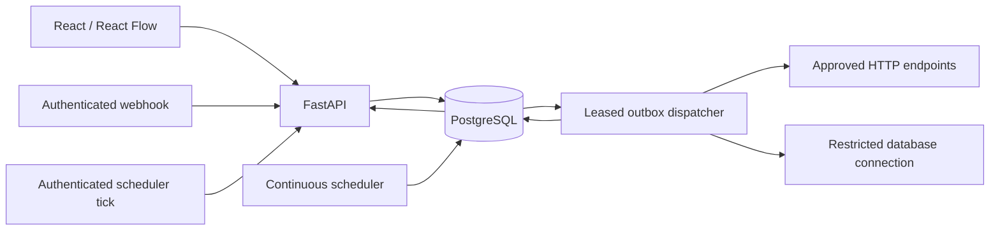

# Architecture

OxyBridge separates the visual workspace, API, execution engine, and durable services. It uses standard ASGI and PostgreSQL interfaces; neither the database nor the hosting environment is tied to a vendor.

## Decisions

| Decision | Implementation |
| --- | --- |
| PostgreSQL is authoritative | Run state and initial work events commit in the same transaction. Acceptance means the run is persisted. |
| A durable outbox handles asynchronous work | `FOR UPDATE SKIP LOCKED` claims coordinate concurrent dispatchers. Claims expire; undelivered work remains recoverable. A separate message broker is unnecessary for this release. |
| Hosts can be persistent or short-lived | Continuous services handle unattended work. Requests can also drain a bounded batch, and an authenticated tick advances schedules, retries, recovery, and retention. |
| Published versions are immutable | Every run pins a version. A database trigger rejects published definition mutation; draft saves use optimistic revisions. |
| Expressions have a constrained grammar | Only supported dot paths in `trigger`, upstream `nodes`, `vars`, `env`, and `run` are resolved. No scripts, `eval`, or remote schema references run. |
| Draft state stays separate from server state | TanStack Query caches server records. Zustand manages graphs, undo history, and in-memory invalid JSON. Only valid graph snapshots enter local recovery storage. |
| Credentials are separate encrypted records | AES-GCM protects connection secrets and runtime bodies. Credential APIs never return stored secrets; execution views redact configured credentials and sensitive fields. |
| Workflows are directed acyclic graphs | One trigger is required. Cycles, orphans, duplicate IDs, unsupported handles, and invalid configuration block publishing. |
| Merge behavior is explicit | A merge waits for every incoming parent to finish; it runs when any selected successful incoming branch reaches it. Unselected branches are skipped. |
| Delivery is at least once | A crash after an external effect but before persistence can repeat the effect. HTTP sends a stable run/node idempotency key. SQL integrations should use business keys and UPSERT. |
| Scheduling uses explicit time zones | UTC timestamps are stored; five-field cron previews use IANA zones. Due rows are claimed atomically and missed occurrences coalesce into one run. |
| Application configuration comes from the environment | `DATABASE_URL` is required. Standard PostgreSQL URL schemes normalize to the installed psycopg driver. Explicit origins replace automatic host-specific trust. |
| One origin is the simplest deployment | A built `web/dist` can be served by the ASGI app. API routes take precedence over the SPA fallback. Hosts may instead serve static assets with their own reverse proxy. |

## Execution and recovery

Run creation records the version, encrypted input, redacted view, node state, request hash, and initial outbox event in one transaction. Reusing an idempotency key with different input returns 409. Orchestration locks the run, finds eligible nodes, and emits execution events.

Node execution refreshes state after acquiring its lock, preventing concurrent duplicate deliveries from starting an already-running attempt. Attempts retain statuses, errors, timings, and HTTP status. Retryable failures schedule a new event using capped backoff and optional jitter. Exhausted or permanent errors retain a dead-letter record.

Recovery creates a new run linked to the original immutable version and input. Cancellation prevents subsequent nodes from starting; an external request already in progress may finish. Expired node leases and outbox claims are recovered without deleting execution evidence.

The default request drain budget is 25 seconds. A started node can consume its configured timeout, so the host must allow more time than that budget. Long delays remain scheduled work in PostgreSQL and do not hold an idle worker. Without a dispatcher or tick, pending work remains persisted but waits to resume.

## Trust boundaries

Access and refresh cookies are opaque and HttpOnly. Mutations require CSRF tokens; staging and production require HTTPS and Secure cookies. Refresh tokens rotate. Passwords use Argon2id. API keys are hashed, expiring, workspace-scoped, and checked against the creator's current permissions. Owner/admin/editor/viewer checks run in the API.

Outbound HTTP validates all DNS results, rejects private addresses by default, pins the selected address while preserving Host/TLS verification, and repeats validation after redirects. Authentication is restricted to approved hosts and never forwarded to another origin; redirect cookies are cleared. Transport and raw authentication headers cannot be saved in workflow definitions.

Database nodes use prepared parameters, a read-only transaction unless writes are explicitly enabled, bounded rows, and a statement timeout. Certificate verification is the default connector mode. Use a dedicated integration role without application-table access; never use the application database owner as a workflow connection.

No redaction policy can infer every sensitive business field. Minimize personal data sent through workflows and configure appropriate payload retention. Preserve encryption keys separately from database backups.

## Deployment boundaries

The container runs as UID 10001. Compose drops capabilities, disables privilege escalation, uses a read-only application filesystem, and provides a writable temporary directory. The application port binds to loopback by default; terminate production HTTPS at a trusted reverse proxy.

PostgreSQL pooling is bounded per process and configurable. Multiple API/dispatcher processes coordinate through database locks, but this release has not established a horizontal scaling or availability SLO. Cold starts, connection limits, downstream latency, and scheduler availability still affect completion time.

OAuth/SSO, an object store for oversized payloads, collaborative editing, a connector marketplace, and a distributed worker autoscaler are future extensions. The current runtime uses PostgreSQL-backed durable state and standard ASGI/container deployment. See [compatibility and verification](verification.md) for supported behavior and operating limits.
